# 数据库说明文档

> 本文件由 `scripts/gen_db_doc.py` 从 MySQL `INFORMATION_SCHEMA` 自动生成, 字段含义取自 ORM 的 `comment`, 枚举取值由脚本内置字典维护。
> 请勿手改: 结构变更后执行 `make db-doc` 重新生成。

- 数据库: `meal_planner` (MySQL 8 / utf8mb4)
- 表数量: **34 张业务表** + `alembic_version` (迁移元数据)
- 字段总数: 316 · 外键总数: 35
- 建表唯一入口: Alembic 迁移 (`make migration MSG="..."` → `make migrate`)

## 一、概述

数据分五块: **用户与偏好**(账号、家庭、口味、过敏、目标、预算)、**菜谱与食材**(食材字典、菜谱、菜谱-食材用量)、**菜单与生成**(周菜单、餐次、异步生成任务)、**库存与采购**(冰箱批次、消耗流水、商品与映射、采购记录)、**自动化与流水**(活动流水、用户级飞书配置)。

依赖方向遵守 `api → services → models`; 表之间通过外键约束保证引用完整性, 删除用户会级联清空其全部业务数据 (`ON DELETE CASCADE`)。

## 二、ER 关系图

```mermaid
erDiagram
    user ||--o{ activity_log : "user_id"
    user ||--|| allergy_restriction : "user_id"
    user ||--|| budget : "user_id"
    console_page ||--o{ console_module : "page_id"
    fridge_inventory ||--o{ consumption_record : "fridge_inventory_id"
    ingredient ||--o{ consumption_record : "ingredient_id"
    menu_item ||--o{ consumption_record : "menu_item_id"
    decision_log ||--o{ decision_feedback : "decision_id"
    user ||--o{ decision_feedback : "user_id"
    recipe ||--o{ decision_log : "recipe_id"
    user ||--o{ decision_log : "user_id"
    user ||--|| diet_preference : "user_id"
    user ||--o{ event : "user_id"
    user ||--o{ feedback : "user_id"
    ingredient ||--o{ fridge_inventory : "ingredient_id"
    user ||--o{ fridge_inventory : "user_id"
    user ||--|| health_goal : "user_id"
    user ||--|| household : "user_id"
    user ||--o{ invite : "invitee_id"
    user ||--o{ invite : "inviter_id"
    user ||--o{ menu : "user_id"
    menu ||--o{ menu_generation_task : "menu_id"
    user ||--o{ menu_generation_task : "user_id"
    menu ||--o{ menu_item : "menu_id"
    recipe ||--o{ menu_item : "recipe_id"
    ingredient ||--o{ product_mapping : "ingredient_id"
    product ||--o{ product_mapping : "product_id"
    product ||--o{ product_price : "product_id"
    product ||--o{ purchase_record : "product_id"
    user ||--o{ purchase_record : "user_id"
    recipe ||--o{ recipe_enrich_log : "recipe_id"
    ingredient ||--o{ recipe_ingredient : "ingredient_id"
    recipe ||--o{ recipe_ingredient : "recipe_id"
    user ||--o{ subscribe_message : "user_id"
    user ||--|| user_feishu_config : "user_id"
```

## 三、表清单

| 模块 | 表 | 说明 | 字段数 | 外键数 |
|---|---|---|---|---|
| 用户与偏好 | `user` | 用户 | 9 | 0 |
| 用户与偏好 | `household` | 家庭 | 9 | 1 |
| 用户与偏好 | `diet_preference` | 饮食偏好 | 9 | 1 |
| 用户与偏好 | `allergy_restriction` | 过敏限制 | 7 | 1 |
| 用户与偏好 | `health_goal` | 健康目标 | 9 | 1 |
| 用户与偏好 | `budget` | 预算 | 9 | 1 |
| 菜谱与食材 | `ingredient` | 食材 | 7 | 0 |
| 菜谱与食材 | `recipe` | 食谱 | 29 | 0 |
| 菜谱与食材 | `recipe_ingredient` | 食谱食材 | 8 | 2 |
| 菜单与生成 | `menu` | 菜单 | 7 | 1 |
| 菜单与生成 | `menu_item` | 菜单项 | 11 | 2 |
| 菜单与生成 | `menu_generation_task` | 菜单生成任务 | 13 | 2 |
| 库存与采购 | `fridge_inventory` | 冰箱库存 | 10 | 2 |
| 库存与采购 | `consumption_record` | 消费记录 | 7 | 3 |
| 库存与采购 | `product` | 商品 | 12 | 0 |
| 库存与采购 | `product_mapping` | 商品映射 | 6 | 2 |
| 库存与采购 | `purchase_record` | 购买记录 | 7 | 2 |
| 自动化与流水 | `activity_log` | 活动日志 | 8 | 1 |
| 自动化与流水 | `user_feishu_config` | 用户飞书配置 | 12 | 1 |
| 迁移元数据 | `alembic_version` | 数据库迁移版本 | 1 | 0 |
| 其他 | `alembic_version_console` | — | 1 | 0 |
| 其他 | `build_info` | 构建信息 | 7 | 0 |
| 其他 | `console_audit_log` | — | 9 | 0 |
| 其他 | `console_capability` | — | 17 | 0 |
| 其他 | `console_meta` | — | 2 | 0 |
| 其他 | `console_module` | — | 14 | 1 |
| 其他 | `console_page` | — | 11 | 0 |
| 其他 | `decision_feedback` | 决策反馈 | 6 | 2 |
| 其他 | `decision_log` | 决策日志 | 16 | 2 |
| 其他 | `event` | 事件 | 8 | 1 |
| 其他 | `feedback` | 反馈 | 8 | 1 |
| 其他 | `invite` | 邀请 | 7 | 2 |
| 其他 | `product_price` | 商品价格 | 5 | 1 |
| 其他 | `recipe_enrich_log` | 菜品富集流水: 定时任务无人值守, 过程必须可追溯 | 9 | 1 |
| 其他 | `subscribe_message` | 订阅消息 | 6 | 1 |

## 四、表结构明细

### 用户与偏好

#### `user` — 用户

| 字段 | 类型 | 可空 | 默认 | 键 | 含义 |
|---|---|---|---|---|---|
| `id` | int | 否 | — | PK/AUTO | 主键编号 |
| `open_id` | varchar(100) | 否 | — | UQ | 飞书 open_id |
| `union_id` | varchar(100) | 是 | — | UQ | 飞书 union_id |
| `name` | varchar(100) | 否 | — | — | 名称 |
| `avatar_url` | varchar(500) | 是 | — | — | 头像链接 |
| `last_login_at` | datetime | 是 | — | — | 最后登录时间 |
| `created_at` | datetime | 否 | CURRENT_TIMESTAMP | — | 创建时间 |
| `updated_at` | datetime | 否 | CURRENT_TIMESTAMP | — | 更新时间 |
| `role` | varchar(20) | 否 | `user` | — | 角色: user/admin/super |

**索引**:
- `ix_user_role` (普通): `role`
- `open_id` (唯一): `open_id`
- `union_id` (唯一): `union_id`

#### `household` — 家庭

| 字段 | 类型 | 可空 | 默认 | 键 | 含义 |
|---|---|---|---|---|---|
| `id` | int | 否 | — | PK/AUTO | 主键编号 |
| `user_id` | int | 否 | — | FK/UQ | 用户编号 |
| `member_count` | int | 否 | — | — | 家庭人数 |
| `meals_per_day` | int | 否 | — | — | 每日餐次 |
| `kitchen_equipments` | varchar(500) | 是 | — | — | 厨房设备 JSON |
| `weekday_cook_minutes` | int | 否 | — | — | 工作日烹饪分钟 |
| `weekend_cook_minutes` | int | 否 | — | — | 周末烹饪分钟 |
| `created_at` | datetime | 否 | CURRENT_TIMESTAMP | — | 创建时间 |
| `updated_at` | datetime | 否 | CURRENT_TIMESTAMP | — | 更新时间 |

**索引**:
- `user_id` (唯一): `user_id`

**外键**:
- `user_id` → `user.id`

#### `diet_preference` — 饮食偏好

| 字段 | 类型 | 可空 | 默认 | 键 | 含义 |
|---|---|---|---|---|---|
| `id` | int | 否 | — | PK/AUTO | 主键编号 |
| `user_id` | int | 否 | — | FK/UQ | 用户编号 |
| `cuisines` | varchar(500) | 是 | — | — | 偏好菜系 JSON |
| `spice_level` | int | 否 | — | — | 辣度等级 |
| `flavor_preference` | varchar(100) | 是 | — | — | 口味偏好 |
| `staple_preference` | varchar(100) | 是 | — | — | 主食偏好 |
| `created_at` | datetime | 否 | CURRENT_TIMESTAMP | — | 创建时间 |
| `updated_at` | datetime | 否 | CURRENT_TIMESTAMP | — | 更新时间 |
| `scene_tags` | varchar(500) | 是 | — | — | 场景标签 JSON 数组 |

**索引**:
- `user_id` (唯一): `user_id`

**外键**:
- `user_id` → `user.id`

#### `allergy_restriction` — 过敏限制

| 字段 | 类型 | 可空 | 默认 | 键 | 含义 |
|---|---|---|---|---|---|
| `id` | int | 否 | — | PK/AUTO | 主键编号 |
| `user_id` | int | 否 | — | FK/UQ | 用户编号 |
| `allergens` | varchar(500) | 是 | — | — | 过敏源 JSON |
| `avoid_ingredients` | text | 是 | — | — | 忌口食材 JSON |
| `dietary_restrictions` | text | 是 | — | — | 饮食限制 |
| `created_at` | datetime | 否 | CURRENT_TIMESTAMP | — | 创建时间 |
| `updated_at` | datetime | 否 | CURRENT_TIMESTAMP | — | 更新时间 |

**索引**:
- `user_id` (唯一): `user_id`

**外键**:
- `user_id` → `user.id`

#### `health_goal` — 健康目标

| 字段 | 类型 | 可空 | 默认 | 键 | 含义 |
|---|---|---|---|---|---|
| `id` | int | 否 | — | PK/AUTO | 主键编号 |
| `user_id` | int | 否 | — | FK/UQ | 用户编号 |
| `goal_type` | varchar(50) | 是 | — | — | 目标类型 |
| `daily_calories` | int | 是 | — | — | 每日卡路里 |
| `protein_pct` | int | 是 | — | — | 蛋白质百分比 |
| `carb_pct` | int | 是 | — | — | 碳水百分比 |
| `fat_pct` | int | 是 | — | — | 脂肪百分比 |
| `created_at` | datetime | 否 | CURRENT_TIMESTAMP | — | 创建时间 |
| `updated_at` | datetime | 否 | CURRENT_TIMESTAMP | — | 更新时间 |

**索引**:
- `user_id` (唯一): `user_id`

**外键**:
- `user_id` → `user.id`

#### `budget` — 预算

| 字段 | 类型 | 可空 | 默认 | 键 | 含义 |
|---|---|---|---|---|---|
| `id` | int | 否 | — | PK/AUTO | 主键编号 |
| `user_id` | int | 否 | — | FK/UQ | 用户编号 |
| `weekday_daily_budget` | float | 否 | — | — | 工作日日预算 |
| `weekend_daily_budget` | float | 否 | — | — | 周末日预算 |
| `weekly_cap` | float | 是 | — | — | 周预算上限 |
| `min_meal_budget` | float | 是 | — | — | 单餐预算下限 |
| `created_at` | datetime | 否 | CURRENT_TIMESTAMP | — | 创建时间 |
| `updated_at` | datetime | 否 | CURRENT_TIMESTAMP | — | 更新时间 |
| `takeout_reference_price` | float | 否 | `26.0` | — | 一顿外卖的参考价(元) |

**索引**:
- `user_id` (唯一): `user_id`

**外键**:
- `user_id` → `user.id`

### 菜谱与食材

#### `ingredient` — 食材

| 字段 | 类型 | 可空 | 默认 | 键 | 含义 |
|---|---|---|---|---|---|
| `id` | int | 否 | — | PK/AUTO | 主键编号 |
| `name` | varchar(100) | 否 | — | UQ | 名称 |
| `category` | varchar(50) | 是 | — | — | 分类 |
| `standard_unit` | varchar(20) | 是 | — | — | 标准单位 |
| `reference_price` | float | 是 | — | — | 参考单价(元/标准单位) |
| `created_at` | datetime | 否 | CURRENT_TIMESTAMP | — | 创建时间 |
| `updated_at` | datetime | 否 | CURRENT_TIMESTAMP | — | 更新时间 |

**索引**:
- `name` (唯一): `name`

#### `recipe` — 食谱

| 字段 | 类型 | 可空 | 默认 | 键 | 含义 |
|---|---|---|---|---|---|
| `id` | int | 否 | — | PK/AUTO | 主键编号 |
| `name` | varchar(200) | 否 | — | — | 名称 |
| `cuisine` | varchar(50) | 是 | — | — | 菜系 |
| `difficulty` | int | 是 | — | — | 难度 |
| `cook_minutes` | int | 是 | — | — | 烹饪分钟 |
| `calories` | int | 是 | — | — | 卡路里 |
| `protein_g` | float | 是 | — | — | 蛋白质克 |
| `carb_g` | float | 是 | — | — | 碳水克 |
| `fat_g` | float | 是 | — | — | 脂肪克 |
| `steps` | text | 是 | — | — | 步骤 |
| `source` | varchar(50) | 是 | — | — | 来源 |
| `created_at` | datetime | 否 | CURRENT_TIMESTAMP | — | 创建时间 |
| `updated_at` | datetime | 否 | CURRENT_TIMESTAMP | — | 更新时间 |
| `category` | varchar(50) | 是 | — | — | 品类: 荤菜/素菜/汤羹/主食/面食/凉菜/小吃 |
| `main_ingredient` | varchar(50) | 是 | — | — | 主料, 判断连续两餐不重样的最小粒度 |
| `tags` | varchar(500) | 是 | — | — | 场景标签 JSON 数组 |
| `flavor_tags` | varchar(500) | 是 | — | — | 味型标签 JSON 数组 |
| `spice_level` | int | 否 | `0` | — | 辣度 0-4 |
| `is_light` | tinyint(1) | 否 | `0` | — | 轻食: 深夜只从这里挑 |
| `cover_text` | varchar(20) | 是 | — | — | 结果卡角标短文本 |
| `quick_steps` | text | 是 | — | — | 极简做法 JSON 数组, 3-5 步 |
| `meal_slots` | varchar(100) | 是 | — | — | 适合餐次 JSON 数组: breakfast/lunch/dinner/late_night |
| `meat_type` | varchar(30) | 是 | — | — | 荤型: none/egg_dairy/poultry/red_meat/seafood/mixed |
| `tools` | varchar(200) | 是 | — | — | 所需厨具 JSON 数组: wok/steamer/oven/air_fryer/... |
| `season` | varchar(60) | 是 | — | — | 时令 JSON 数组: spring/summer/autumn/winter |
| `enrich_status` | varchar(20) | 否 | `pending` | — | 富集状态: pending/partial/done/failed |
| `enriched_at` | datetime | 是 | — | — | 最近一次富集时间 |
| `enrich_source` | varchar(30) | 是 | — | — | 字段来源: seed/rule/llm/manual |
| `steps_source` | varchar(30) | 是 | — | — | 做法来源: seed/rule/llm/manual |

**索引**:
- `ix_recipe_enrich_status` (普通): `enrich_status`

#### `recipe_ingredient` — 食谱食材

| 字段 | 类型 | 可空 | 默认 | 键 | 含义 |
|---|---|---|---|---|---|
| `id` | int | 否 | — | PK/AUTO | 主键编号 |
| `recipe_id` | int | 否 | — | FK | 食谱编号 |
| `ingredient_id` | int | 否 | — | FK | 食材编号 |
| `quantity` | float | 是 | — | — | 用量(标准单位) |
| `unit` | varchar(20) | 否 | — | — | 单位 |
| `amount_text` | varchar(50) | 是 | — | — | 原始用量文本 |
| `created_at` | datetime | 否 | CURRENT_TIMESTAMP | — | 创建时间 |
| `updated_at` | datetime | 否 | CURRENT_TIMESTAMP | — | 更新时间 |

**索引**:
- `ingredient_id` (普通): `ingredient_id`
- `recipe_id` (普通): `recipe_id`

**外键**:
- `ingredient_id` → `ingredient.id`
- `recipe_id` → `recipe.id`

### 菜单与生成

#### `menu` — 菜单

| 字段 | 类型 | 可空 | 默认 | 键 | 含义 |
|---|---|---|---|---|---|
| `id` | int | 否 | — | PK/AUTO | 主键编号 |
| `user_id` | int | 否 | — | FK | 用户编号 |
| `week_start_date` | date | 否 | — | — | 周起始日期(周一) |
| `status` | varchar(20) | 否 | — | — | 状态 |
| `created_at` | datetime | 否 | CURRENT_TIMESTAMP | — | 创建时间 |
| `updated_at` | datetime | 否 | CURRENT_TIMESTAMP | — | 更新时间 |
| `source` | varchar(20) | 否 | `ai` | — | 菜单来源: local/ai/mixed |

**索引**:
- `ix_menu_user_status` (普通): `user_id`, `status`
- `ix_menu_user_week` (普通): `user_id`, `week_start_date`

**外键**:
- `user_id` → `user.id`

#### `menu_item` — 菜单项

| 字段 | 类型 | 可空 | 默认 | 键 | 含义 |
|---|---|---|---|---|---|
| `id` | int | 否 | — | PK/AUTO | 主键编号 |
| `menu_id` | int | 否 | — | FK | 菜单编号 |
| `recipe_id` | int | 是 | — | FK | 食谱编号 |
| `meal_date` | date | 否 | — | — | 餐日期 |
| `meal_type` | varchar(20) | 否 | — | — | 餐类型 |
| `is_locked` | tinyint(1) | 否 | — | — | 是否锁定 |
| `is_cooked` | tinyint(1) | 否 | — | — | 是否已烹饪 |
| `cook_mode` | varchar(20) | 否 | — | — | 烹饪模式 |
| `estimated_cost` | float | 是 | — | — | 预估成本(元) |
| `created_at` | datetime | 否 | CURRENT_TIMESTAMP | — | 创建时间 |
| `rejected_recipe_ids` | text | 是 | — | — | 本餐被「换一道」换掉的菜谱 id JSON 数组, 避免来回横跳 |

**索引**:
- `ix_menu_item_menu_date` (普通): `menu_id`, `meal_date`
- `recipe_id` (普通): `recipe_id`

**外键**:
- `menu_id` → `menu.id`
- `recipe_id` → `recipe.id`

#### `menu_generation_task` — 菜单生成任务

| 字段 | 类型 | 可空 | 默认 | 键 | 含义 |
|---|---|---|---|---|---|
| `id` | int | 否 | — | PK/AUTO | 主键编号 |
| `user_id` | int | 否 | — | FK | 用户编号 |
| `status` | varchar(20) | 否 | — | — | 状态 |
| `menu_id` | int | 是 | — | FK | 菜单编号 |
| `week_start_date` | date | 否 | — | — | 周开始日期 |
| `request_payload` | text | 是 | — | — | 请求负载 |
| `error` | text | 是 | — | — | 错误 |
| `attempts` | int | 否 | — | — | 尝试次数 |
| `started_at` | datetime | 是 | — | — | 开始时间 |
| `finished_at` | datetime | 是 | — | — | 结束时间 |
| `created_at` | datetime | 否 | CURRENT_TIMESTAMP | — | 创建时间 |
| `updated_at` | datetime | 否 | CURRENT_TIMESTAMP | — | 更新时间 |
| `is_regeneration` | tinyint(1) | 否 | `0` | — | 是否为重新生成 (走独立配额, 不占用首次生成额度) |

**索引**:
- `ix_menu_task_status_created` (普通): `status`, `created_at`
- `ix_menu_task_user_created` (普通): `user_id`, `created_at`
- `ix_menu_task_user_regen` (普通): `user_id`, `is_regeneration`, `created_at`
- `menu_id` (普通): `menu_id`

**外键**:
- `menu_id` → `menu.id`
- `user_id` → `user.id`

### 库存与采购

#### `fridge_inventory` — 冰箱库存

| 字段 | 类型 | 可空 | 默认 | 键 | 含义 |
|---|---|---|---|---|---|
| `id` | int | 否 | — | PK/AUTO | 主键编号 |
| `user_id` | int | 否 | — | FK | 用户编号 |
| `ingredient_id` | int | 否 | — | FK | 食材编号 |
| `quantity` | float | 否 | — | — | 数量 |
| `unit` | varchar(20) | 否 | — | — | 单位 |
| `purchase_date` | date | 是 | — | — | 购买日期 |
| `expiry_date` | date | 是 | — | — | 过期日期 |
| `source` | varchar(50) | 是 | — | — | 来源 |
| `created_at` | datetime | 否 | CURRENT_TIMESTAMP | — | 创建时间 |
| `updated_at` | datetime | 否 | CURRENT_TIMESTAMP | — | 更新时间 |

**索引**:
- `ingredient_id` (普通): `ingredient_id`
- `user_id` (普通): `user_id`

**外键**:
- `ingredient_id` → `ingredient.id`
- `user_id` → `user.id`

#### `consumption_record` — 消费记录

| 字段 | 类型 | 可空 | 默认 | 键 | 含义 |
|---|---|---|---|---|---|
| `id` | int | 否 | — | PK/AUTO | 主键编号 |
| `fridge_inventory_id` | int | 是 | — | FK | 冰箱库存编号 |
| `menu_item_id` | int | 是 | — | FK | 菜单项编号 |
| `quantity` | float | 否 | — | — | 数量 |
| `consumed_at` | datetime | 否 | CURRENT_TIMESTAMP | — | 消费时间 |
| `ingredient_id` | int | 是 | — | FK | 食材 |
| `unit` | varchar(20) | 是 | — | — | 消耗时的单位 |

**索引**:
- `fk_consumption_record_ingredient` (普通): `ingredient_id`
- `fk_consumption_record_inventory` (普通): `fridge_inventory_id`
- `menu_item_id` (普通): `menu_item_id`

**外键**:
- `fridge_inventory_id` → `fridge_inventory.id`
- `ingredient_id` → `ingredient.id`
- `menu_item_id` → `menu_item.id`

#### `product` — 商品

| 字段 | 类型 | 可空 | 默认 | 键 | 含义 |
|---|---|---|---|---|---|
| `id` | int | 否 | — | PK/AUTO | 主键编号 |
| `source_platform` | varchar(50) | 否 | — | — | 来源平台 |
| `sku_id` | varchar(200) | 否 | — | — | SKU编号 |
| `name` | varchar(500) | 否 | — | — | 名称 |
| `category` | varchar(100) | 是 | — | — | 分类 |
| `price` | float | 否 | — | — | 价格 |
| `unit` | varchar(50) | 是 | — | — | 单位 |
| `is_active` | tinyint(1) | 否 | — | — | 是否启用 |
| `in_stock` | tinyint(1) | 否 | — | — | 是否有货 |
| `price_changed` | tinyint(1) | 否 | — | — | 价格变动 |
| `updated_at` | datetime | 否 | CURRENT_TIMESTAMP | — | 更新时间 |
| `created_at` | datetime | 否 | CURRENT_TIMESTAMP | — | 创建时间 |

**索引**:
- `uq_product_platform_sku` (唯一): `source_platform`, `sku_id`

#### `product_mapping` — 商品映射

| 字段 | 类型 | 可空 | 默认 | 键 | 含义 |
|---|---|---|---|---|---|
| `id` | int | 否 | — | PK/AUTO | 主键编号 |
| `ingredient_id` | int | 否 | — | FK | 食材编号 |
| `product_id` | int | 否 | — | FK | 商品编号 |
| `match_score` | float | 否 | — | — | 匹配评分 |
| `user_confirmed` | tinyint(1) | 否 | — | — | 用户已确认 |
| `created_at` | datetime | 否 | CURRENT_TIMESTAMP | — | 创建时间 |

**索引**:
- `product_id` (普通): `product_id`
- `uq_mapping_ingredient_product` (唯一): `ingredient_id`, `product_id`

**外键**:
- `ingredient_id` → `ingredient.id`
- `product_id` → `product.id`

#### `purchase_record` — 购买记录

| 字段 | 类型 | 可空 | 默认 | 键 | 含义 |
|---|---|---|---|---|---|
| `id` | int | 否 | — | PK/AUTO | 主键编号 |
| `user_id` | int | 否 | — | FK | 用户编号 |
| `product_id` | int | 是 | — | FK | 商品编号 |
| `quantity` | float | 否 | — | — | 数量 |
| `amount` | float | 否 | — | — | 金额 |
| `platform` | varchar(50) | 否 | — | — | 平台 |
| `purchased_at` | datetime | 否 | CURRENT_TIMESTAMP | — | 购买时间 |

**索引**:
- `product_id` (普通): `product_id`
- `user_id` (普通): `user_id`

**外键**:
- `product_id` → `product.id`
- `user_id` → `user.id`

### 自动化与流水

#### `activity_log` — 活动日志

| 字段 | 类型 | 可空 | 默认 | 键 | 含义 |
|---|---|---|---|---|---|
| `id` | int | 否 | — | PK/AUTO | 主键编号 |
| `user_id` | int | 否 | — | FK | 所属用户 |
| `channel` | varchar(20) | 否 | — | — | 通道: feishu/vision/system |
| `kind` | varchar(40) | 否 | — | — | 事件类型: daily_menu_push/evening_check/expiry_check/vision_recognize |
| `title` | varchar(200) | 否 | — | — | 一句话说明 |
| `detail` | text | 是 | — | — | 补充说明 |
| `status` | varchar(20) | 否 | — | — | 结果: sent/failed/skipped |
| `occurred_at` | datetime | 否 | CURRENT_TIMESTAMP | — | 发生时间 |

**索引**:
- `ix_activity_user_kind_time` (普通): `user_id`, `kind`, `occurred_at`

**外键**:
- `user_id` → `user.id`

#### `user_feishu_config` — 用户飞书配置

| 字段 | 类型 | 可空 | 默认 | 键 | 含义 |
|---|---|---|---|---|---|
| `id` | int | 否 | — | PK/AUTO | 主键编号 |
| `user_id` | int | 否 | — | FK/UQ | 所属用户 - 一个用户一份配置 |
| `app_id` | varchar(100) | 否 | — | — | 飞书应用的 App ID |
| `app_secret_encrypted` | text | 否 | — | — | App Secret, 用 secret_box 加密后存储 |
| `receive_id` | varchar(200) | 否 | — | — | 接收方 ID (自己的 open_id 或群 chat_id) |
| `receive_id_type` | varchar(20) | 否 | `open_id` | — | 接收方 ID 类型: open_id / chat_id / email |
| `enabled` | tinyint(1) | 否 | `1` | — | 关掉后保留配置但不再推送 |
| `remark` | varchar(100) | 否 | — | — | 给自己看的备注 |
| `last_verified_at` | datetime | 是 | — | — | 最近一次测试推送成功的时间 |
| `last_error` | text | 是 | — | — | 最近一次推送失败原因 |
| `created_at` | datetime | 否 | CURRENT_TIMESTAMP | — | 创建时间 |
| `updated_at` | datetime | 否 | CURRENT_TIMESTAMP | — | 更新时间 |

**索引**:
- `uq_user_feishu_config_user` (唯一): `user_id`

**外键**:
- `user_id` → `user.id`

### 迁移元数据

#### `alembic_version` — 数据库迁移版本

| 字段 | 类型 | 可空 | 默认 | 键 | 含义 |
|---|---|---|---|---|---|
| `version_num` | varchar(32) | 否 | — | PK | 版本号 |

#### `alembic_version_console`

| 字段 | 类型 | 可空 | 默认 | 键 | 含义 |
|---|---|---|---|---|---|
| `version_num` | varchar(32) | 否 | — | PK | — |

#### `build_info` — 构建信息

| 字段 | 类型 | 可空 | 默认 | 键 | 含义 |
|---|---|---|---|---|---|
| `id` | int | 否 | — | PK/AUTO | 主键编号 |
| `version` | varchar(20) | 否 | — | — | 小程序版本号 |
| `min_version` | varchar(20) | 否 | — | — | 低于此版本强制升级 |
| `force_update` | tinyint(1) | 否 | `0` | — | 是否强制升级 |
| `notes` | text | 是 | — | — | 升级说明 |
| `update_url` | varchar(500) | 是 | — | — | 跳转链接 (H5 / 商店 / 二维码页) |
| `released_at` | datetime | 否 | CURRENT_TIMESTAMP | — | 发布时间 |

**索引**:
- `ix_build_info_released_at` (普通): `released_at`

#### `console_audit_log`

| 字段 | 类型 | 可空 | 默认 | 键 | 含义 |
|---|---|---|---|---|---|
| `id` | int | 否 | — | PK/AUTO | 主键, 自增 |
| `actor_user_id` | int | 是 | — | — | 操作者 user.id; 系统行为留空 |
| `actor_name` | varchar(100) | 是 | — | — | 操作者昵称快照, 用户被删也能追溯 |
| `action` | varchar(40) | 否 | — | — | 动作: create/update/delete/reorder/set_role |
| `target_type` | varchar(30) | 否 | — | — | 对象: page/module/capability/user |
| `target_id` | varchar(60) | 是 | — | — | — |
| `before_json` | text | 是 | — | — | 变更前快照 |
| `after_json` | text | 是 | — | — | 变更后快照 |
| `created_at` | datetime | 否 | CURRENT_TIMESTAMP | — | 操作时间 |

**索引**:
- `ix_console_audit_created` (普通): `created_at`

#### `console_capability`

| 字段 | 类型 | 可空 | 默认 | 键 | 含义 |
|---|---|---|---|---|---|
| `id` | int | 否 | — | PK/AUTO | 主键, 自增 |
| `cap_key` | varchar(60) | 否 | — | UQ | 能力唯一键, 如 decide/menuGenerate |
| `method` | varchar(10) | 否 | — | — | GET/POST/PUT/DELETE |
| `path` | varchar(200) | 否 | — | — | 上游路径, 支持 {menuId} 占位 |
| `title` | varchar(80) | 否 | — | — | — |
| `desc` | text | 是 | — | — | — |
| `group_name` | varchar(30) | 否 | — | — | 分区: 连接与身份/今天吃啥/... |
| `fields_json` | text | 是 | — | — | 入参字段定义 JSON 数组 |
| `keys_json` | text | 是 | — | — | 结果摘要优先展示的字段路径 JSON 数组 |
| `write_flag` | tinyint(1) | 否 | `0` | — | 写操作: 调用前二次确认 |
| `danger_flag` | tinyint(1) | 否 | `0` | — | 危险操作: 按钮标红 |
| `multipart_flag` | tinyint(1) | 否 | `0` | — | 是否为文件上传 |
| `public_flag` | tinyint(1) | 否 | `0` | — | 未登录也可调用 |
| `enabled` | tinyint(1) | 否 | `1` | — | 是否对用户可见 |
| `order_no` | int | 否 | `0` | — | — |
| `created_at` | datetime | 否 | CURRENT_TIMESTAMP | — | 创建时间 |
| `updated_at` | datetime | 否 | CURRENT_TIMESTAMP | — | 更新时间 |

**索引**:
- `cap_key` (唯一): `cap_key`
- `ix_console_capability_group` (普通): `group_name`, `order_no`

#### `console_meta`

| 字段 | 类型 | 可空 | 默认 | 键 | 含义 |
|---|---|---|---|---|---|
| `key` | varchar(60) | 否 | — | PK | 键 |
| `value` | text | 是 | — | — | 值 |

#### `console_module`

| 字段 | 类型 | 可空 | 默认 | 键 | 含义 |
|---|---|---|---|---|---|
| `id` | int | 否 | — | PK/AUTO | 主键, 自增 |
| `page_id` | int | 否 | — | FK | 所属页面 |
| `module_key` | varchar(60) | 否 | — | — | 模块业务键, 同一页面内唯一, 便于增量更新 |
| `widget_type` | varchar(40) | 否 | — | — | 组件类型: capability-form/stat-tiles/data-table/... |
| `title` | varchar(80) | 否 | — | — | 区块标题 |
| `subtitle` | varchar(120) | 是 | — | — | — |
| `span` | int | 否 | `1` | — | 窄屏占几列 (Bento 共 2 列) |
| `lg` | int | 是 | — | — | 宽屏占几列 (共 6 列) |
| `order_no` | int | 否 | `0` | — | 页面内排序 |
| `visible` | tinyint(1) | 否 | `1` | — | 是否渲染 |
| `permission` | varchar(20) | 否 | `user` | — | 可见所需权限: guest/user/admin |
| `props_json` | text | 是 | — | — | 组件属性 JSON, 形状由前端 propSchema 约束 |
| `created_at` | datetime | 否 | CURRENT_TIMESTAMP | — | 创建时间 |
| `updated_at` | datetime | 否 | CURRENT_TIMESTAMP | — | 更新时间 |

**索引**:
- `ix_console_module_key` (唯一): `page_id`, `module_key`
- `ix_console_module_page` (普通): `page_id`, `order_no`

**外键**:
- `page_id` → `console_page.id`

#### `console_page`

| 字段 | 类型 | 可空 | 默认 | 键 | 含义 |
|---|---|---|---|---|---|
| `id` | int | 否 | — | PK/AUTO | 主键, 自增 |
| `slug` | varchar(50) | 否 | — | UQ | 路由短名: home/decide/menus/fridge/pref/more |
| `title` | varchar(50) | 否 | — | — | 页面标题 |
| `icon` | varchar(30) | 否 | — | — | 图标名, 对应前端 ICONS |
| `subtitle` | varchar(100) | 是 | — | — | 副标题 |
| `order_no` | int | 否 | `0` | — | Tab 顺序 |
| `visible` | tinyint(1) | 否 | `1` | — | 是否出现在 TabBar |
| `layout` | varchar(20) | 否 | — | — | 移动端一律纵向流式 stack |
| `version` | int | 否 | `1` | — | 配置版本号 |
| `created_at` | datetime | 否 | CURRENT_TIMESTAMP | — | 创建时间 |
| `updated_at` | datetime | 否 | CURRENT_TIMESTAMP | — | 更新时间 |

**索引**:
- `ix_console_page_order` (普通): `order_no`
- `slug` (唯一): `slug`

#### `decision_feedback` — 决策反馈

| 字段 | 类型 | 可空 | 默认 | 键 | 含义 |
|---|---|---|---|---|---|
| `id` | int | 否 | — | PK/AUTO | 主键编号 |
| `decision_id` | int | 否 | — | FK | 决策编号 |
| `user_id` | int | 否 | — | FK | 用户编号 |
| `liked` | tinyint(1) | 否 | — | — | 是否喜欢 |
| `round_index` | int | 否 | `1` | — | 轮次索引 |
| `created_at` | datetime | 否 | CURRENT_TIMESTAMP | — | 创建时间 |

**索引**:
- `fk_decision_fb_decision` (普通): `decision_id`
- `ix_decision_fb_user_created` (普通): `user_id`, `created_at`

**外键**:
- `decision_id` → `decision_log.id`
- `user_id` → `user.id`

#### `decision_log` — 决策日志

| 字段 | 类型 | 可空 | 默认 | 键 | 含义 |
|---|---|---|---|---|---|
| `id` | int | 否 | — | PK/AUTO | 主键编号 |
| `user_id` | int | 否 | — | FK | 用户编号 |
| `recipe_id` | int | 是 | — | FK | 食谱编号 |
| `dish_name` | varchar(200) | 否 | — | — | 菜名(冗余, recipe 可删) |
| `dish_category` | varchar(50) | 是 | — | — | 菜品分类 |
| `dish_cuisine` | varchar(50) | 是 | — | — | 菜品菜系 |
| `main_ingredient` | varchar(50) | 是 | — | — | 主要食材 |
| `decision_date` | date | 否 | — | — | 决策日期 |
| `meal_slot` | varchar(20) | 否 | `dinner` | — | 餐时段 |
| `source` | varchar(20) | 否 | `local` | — | 来源 |
| `reason` | varchar(100) | 是 | — | — | 原因 |
| `weather` | varchar(20) | 是 | — | — | 天气 |
| `accepted` | tinyint(1) | 是 | — | — | null未表态/true就这个/false换一个 |
| `payload` | text | 是 | — | — | 决策快照 JSON, GET /decide/last 冷启动秒开用 |
| `created_at` | datetime | 否 | CURRENT_TIMESTAMP | — | 创建时间 |
| `updated_at` | datetime | 否 | CURRENT_TIMESTAMP | — | 更新时间 |

**索引**:
- `fk_decision_log_recipe` (普通): `recipe_id`
- `ix_decision_user_created` (普通): `user_id`, `created_at`
- `ix_decision_user_date` (普通): `user_id`, `decision_date`

**外键**:
- `recipe_id` → `recipe.id`
- `user_id` → `user.id`

#### `event` — 事件

| 字段 | 类型 | 可空 | 默认 | 键 | 含义 |
|---|---|---|---|---|---|
| `id` | bigint | 否 | — | PK/AUTO | 主键编号 |
| `user_id` | int | 是 | — | FK | 触发用户, 匿名事件为空 |
| `event_name` | varchar(64) | 否 | — | — | 事件名 e.g. 'login' / 'generate_menu' |
| `ts` | bigint | 否 | — | — | 客户端 Unix 毫秒时间戳 |
| `properties` | text | 是 | — | — | 业务字段 JSON 字符串 |
| `app_version` | varchar(40) | 是 | — | — | 小程序版本号 |
| `platform` | varchar(40) | 是 | — | — | 客户端平台 (weapp/h5/mini-app) |
| `received_at` | datetime | 否 | CURRENT_TIMESTAMP | — | 接收时间 |

**索引**:
- `ix_event_name_ts` (普通): `event_name`, `ts`
- `ix_event_received_at` (普通): `received_at`
- `ix_event_user_ts` (普通): `user_id`, `ts`

**外键**:
- `user_id` → `user.id`

#### `feedback` — 反馈

| 字段 | 类型 | 可空 | 默认 | 键 | 含义 |
|---|---|---|---|---|---|
| `id` | int | 否 | — | PK/AUTO | 主键编号 |
| `user_id` | int | 是 | — | FK | 所属用户, 匿名反馈为空 |
| `category` | varchar(20) | 否 | `other` | — | 反馈类型: bug/suggestion/recipe/other |
| `content` | text | 否 | — | — | 反馈内容 |
| `contact` | varchar(100) | 是 | — | — | 联系方式 (邮箱/微信), 可选 |
| `device_info` | text | 是 | — | — | 设备信息 JSON: 型号/系统/微信版本/客户端版本 |
| `status` | varchar(20) | 否 | `open` | — | 状态: open/processing/closed |
| `created_at` | datetime | 否 | CURRENT_TIMESTAMP | — | 提交时间 |

**索引**:
- `ix_feedback_status_created` (普通): `status`, `created_at`
- `ix_feedback_user_created` (普通): `user_id`, `created_at`

**外键**:
- `user_id` → `user.id`

#### `invite` — 邀请

| 字段 | 类型 | 可空 | 默认 | 键 | 含义 |
|---|---|---|---|---|---|
| `id` | int | 否 | — | PK/AUTO | 主键编号 |
| `inviter_id` | int | 否 | — | FK | 邀请人 |
| `invitee_id` | int | 是 | — | FK | 被邀请人, 兑换后填 |
| `invite_code` | varchar(20) | 否 | — | UQ | 邀请码 (短码) |
| `rewarded` | tinyint(1) | 否 | `0` | — | 奖励是否已发放 |
| `created_at` | datetime | 否 | CURRENT_TIMESTAMP | — | 创建时间 |
| `redeemed_at` | datetime | 是 | — | — | 被邀请人兑换时间 |

**索引**:
- `fk_invite_invitee` (普通): `invitee_id`
- `ix_invite_code` (普通): `invite_code`
- `ix_invite_inviter` (普通): `inviter_id`, `created_at`
- `uq_invite_code` (唯一): `invite_code`

**外键**:
- `invitee_id` → `user.id`
- `inviter_id` → `user.id`

#### `product_price` — 商品价格

| 字段 | 类型 | 可空 | 默认 | 键 | 含义 |
|---|---|---|---|---|---|
| `id` | bigint | 否 | — | PK/AUTO | 主键编号 |
| `product_id` | int | 否 | — | FK | 商品编号 |
| `price` | float | 否 | `0` | — | 价格 |
| `captured_at` | datetime | 否 | CURRENT_TIMESTAMP | — | 采集时间 |
| `source` | varchar(50) | 是 | `scheduler` | — | 来源 |

**索引**:
- `ix_product_price_product_captured` (普通): `product_id`, `captured_at`

**外键**:
- `product_id` → `product.id`

#### `recipe_enrich_log` — 菜品富集流水: 定时任务无人值守, 过程必须可追溯

| 字段 | 类型 | 可空 | 默认 | 键 | 含义 |
|---|---|---|---|---|---|
| `id` | int | 否 | — | PK/AUTO | 主键, 自增 |
| `recipe_id` | int | 是 | — | FK | EXPAND 成功前为 NULL |
| `dish_name` | varchar(200) | 否 | — | — | 菜名(冗余) |
| `kind` | varchar(20) | 否 | `fields` | — | fields/steps/expand |
| `status` | varchar(20) | 否 | — | — | ok/skipped/failed |
| `provider` | varchar(30) | 否 | `` | — | llm 链里真正用上的客户端名 |
| `fields` | varchar(300) | 是 | — | — | 本次写入的字段名 |
| `message` | varchar(500) | 是 | — | — | 失败原因/备注 |
| `created_at` | datetime | 否 | CURRENT_TIMESTAMP | — | 创建时间 |

**索引**:
- `ix_recipe_enrich_created` (普通): `created_at`
- `recipe_id` (普通): `recipe_id`

**外键**:
- `recipe_id` → `recipe.id`

#### `subscribe_message` — 订阅消息

| 字段 | 类型 | 可空 | 默认 | 键 | 含义 |
|---|---|---|---|---|---|
| `id` | int | 否 | — | PK/AUTO | 主键编号 |
| `user_id` | int | 否 | — | FK | 用户编号 |
| `template_id` | varchar(100) | 否 | — | — | 微信后台的订阅消息模板 ID |
| `granted_at` | datetime | 否 | CURRENT_TIMESTAMP | — | 最近一次用户授权时间 |
| `last_declined_at` | datetime | 是 | — | — | 最近一次用户拒绝时间 |
| `last_send_at` | datetime | 是 | — | — | 最近一次实际推送时间 |

**索引**:
- `uq_subscribe_user_template` (唯一): `user_id`, `template_id`

**外键**:
- `user_id` → `user.id`

## 五、枚举与受控取值

以下字段以字符串存储受控取值 (代码常量, 非数据库 ENUM):

| 表 | 字段 | 取值 |
|---|---|---|
| `activity_log` | `channel` | feishu 飞书 / vision 拍照识别 / system 系统 |
| `activity_log` | `kind` | daily_menu_push 每日菜单推送 / evening_check 晚间库存监测 / expiry_check 临期检查 / vision_recognize 拍照识别 |
| `activity_log` | `status` | sent 已发送 / failed 失败 / skipped 已跳过 |
| `fridge_inventory` | `source` | manual 手动添加 / xiaoxiang_auto 小象超市自动 |
| `health_goal` | `goal_type` | 减脂 / 增肌 / 控糖 / 控压 / 维持 |
| `ingredient` | `category` | 蔬菜 / 水果 / 肉禽蛋 / 水产 / 调味品 / 乳制品 / 主食 / 坚果 |
| `menu` | `status` | draft 草稿(可编辑) / confirmed 已确认 / active 执行期 / completed 本周结束 |
| `menu_generation_task` | `status` | pending 待领取 / running 执行中 / succeeded 成功 / failed 失败 |
| `menu_item` | `cook_mode` | self 自做 / takeout 外卖 |
| `menu_item` | `meal_type` | breakfast 早餐 / lunch 午餐 / dinner 晚餐 |
| `product` | `source_platform` | xiaoxiang 小象超市 / meituan_waimai 美团外卖 |
| `purchase_record` | `platform` | xiaoxiang 小象超市 / meituan_waimai 美团外卖 / manual 手动 |
| `recipe` | `source` | ai_generated AI 生成 / user_created 用户创建 / template 模板 / howtocook 导入(HowToCook) / proj_kitchen 导入(proj.kitchen) |
| `user` | `open_id` | ou_* 飞书 / wechat:* 微信小程序 / dev:* 本地开发 |
| `user_feishu_config` | `receive_id_type` | open_id / chat_id / email |

## 六、迁移历史

| 版本 | 说明 |
|---|---|
| `0001_init` | 基线: 19 张业务表 |
| `0002_consumption_record_keeps_history` | 消耗流水保留历史 (SET NULL) |
| `0003_v2_today_and_brand` | 今日页与品牌 (activity_log 等) |
| `0004_consumption_record_identity` | 消耗流水自解释 (ingredient_id/unit) |
| `0005_generation_task_regeneration` | 生成任务重生成配额 (is_regeneration) |
| `0006_user_feishu_config` | 用户级飞书机器人配置 |
| `0007_v23_menu_source` | 菜单来源标识 (menu.source: local/ai/mixed) |
