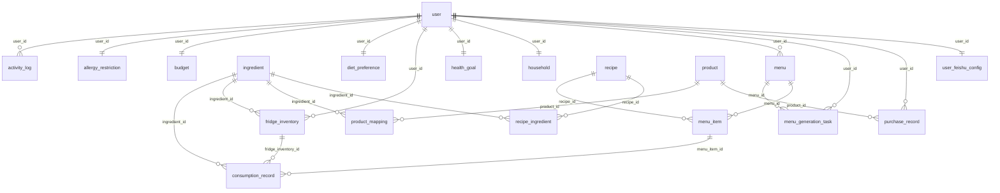

# 数据库说明文档

> 本文件由 `scripts/gen_db_doc.py` 从 MySQL `INFORMATION_SCHEMA` 自动生成, 字段含义取自 ORM 的 `comment`, 枚举取值由脚本内置字典维护。
> 请勿手改: 结构变更后执行 `make db-doc` 重新生成。

- 数据库: `meal_planner` (MySQL 8 / utf8mb4)
- 表数量: **19 张业务表** + `alembic_version` (迁移元数据)
- 字段总数: 171 · 外键总数: 23
- 建表唯一入口: Alembic 迁移 (`make migration MSG="..."` → `make migrate`)

## 一、概述

数据分五块: **用户与偏好**(账号、家庭、口味、过敏、目标、预算)、**菜谱与食材**(食材字典、菜谱、菜谱-食材用量)、**菜单与生成**(周菜单、餐次、异步生成任务)、**库存与采购**(冰箱批次、消耗流水、商品与映射、采购记录)、**自动化与流水**(活动流水、用户级飞书配置)。

依赖方向遵守 `api → services → models`; 表之间通过外键约束保证引用完整性, 删除用户会级联清空其全部业务数据 (`ON DELETE CASCADE`)。

## 二、ER 关系图

## 三、表清单

| 模块 | 表 | 说明 | 字段数 | 外键数 |
|---|---|---|---|---|
| 用户与偏好 | `user` | 平台用户 (飞书扫码 / 微信小程序 / 本地开发登录) | 8 | 0 |
| 用户与偏好 | `household` | 家庭规模与做饭时间约束 | 9 | 1 |
| 用户与偏好 | `diet_preference` | 口味偏好 (菜系 / 辣度 / 主食) | 8 | 1 |
| 用户与偏好 | `allergy_restriction` | 过敏源与忌口 (硬约束) | 7 | 1 |
| 用户与偏好 | `health_goal` | 健康目标与每日营养配比 | 9 | 1 |
| 用户与偏好 | `budget` | 预算配置 (工作日 / 周末 / 周上限 / 外卖参考价) | 9 | 1 |
| 菜谱与食材 | `ingredient` | 食材字典 (唯一名 + 分类 + 标准单位 + 参考单价) | 7 | 0 |
| 菜谱与食材 | `recipe` | 菜谱库 (AI 生成 / 用户创建 / 开源导入) | 13 | 0 |
| 菜谱与食材 | `recipe_ingredient` | 菜谱↔食材用量关联 | 8 | 2 |
| 菜单与生成 | `menu` | 周菜单 (按用户 + 周起始日) | 7 | 1 |
| 菜单与生成 | `menu_item` | 菜单餐次 (7 天 × 餐次, 承载换菜 / 锁定 / 已做) | 10 | 2 |
| 菜单与生成 | `menu_generation_task` | 异步生成任务队列 (worker 抢占执行 + 配额计数) | 13 | 2 |
| 库存与采购 | `fridge_inventory` | 冰箱库存批次 (含保质期) | 10 | 2 |
| 库存与采购 | `consumption_record` | 库存消耗流水 (标记已做的账, 可撤销) | 7 | 3 |
| 库存与采购 | `product` | 电商商品库 (二期采集占位) | 12 | 0 |
| 库存与采购 | `product_mapping` | 食材↔商品匹配 (二期) | 6 | 2 |
| 库存与采购 | `purchase_record` | 采购记录 (补单 / 手动) | 7 | 2 |
| 自动化与流水 | `activity_log` | 活动流水 (推送 / 识别 / 配额计数) | 8 | 1 |
| 自动化与流水 | `user_feishu_config` | 用户级飞书机器人凭证 (加密存储) | 12 | 1 |
| 迁移元数据 | `alembic_version` | 迁移版本元数据 | 1 | 0 |

## 四、表结构明细

### 用户与偏好

#### `user` — 平台用户 (飞书扫码 / 微信小程序 / 本地开发登录)

| 字段 | 类型 | 可空 | 默认 | 键 | 含义 |
|---|---|---|---|---|---|
| `id` | int | 否 | — | PK/AUTO | 主键, 自增 |
| `open_id` | varchar(100) | 否 | — | UQ | 飞书 open_id |
| `union_id` | varchar(100) | 是 | — | UQ | 飞书 union_id |
| `name` | varchar(100) | 否 | — | — | 昵称 |
| `avatar_url` | varchar(500) | 是 | — | — | 头像地址 |
| `last_login_at` | datetime | 是 | — | — | 最近登录时间 |
| `created_at` | datetime | 否 | CURRENT_TIMESTAMP | — | 创建时间 |
| `updated_at` | datetime | 否 | CURRENT_TIMESTAMP | — | 更新时间 |

**索引**:
- `open_id` (唯一): `open_id`
- `union_id` (唯一): `union_id`

#### `household` — 家庭规模与做饭时间约束

| 字段 | 类型 | 可空 | 默认 | 键 | 含义 |
|---|---|---|---|---|---|
| `id` | int | 否 | — | PK/AUTO | 主键, 自增 |
| `user_id` | int | 否 | — | FK/UQ | 所属用户, 级联删除 |
| `member_count` | int | 否 | — | — | 家庭人数 |
| `meals_per_day` | int | 否 | — | — | 每日餐次 |
| `kitchen_equipments` | varchar(500) | 是 | — | — | 厨房设备 JSON |
| `weekday_cook_minutes` | int | 否 | — | — | 工作日做饭时间(分钟) |
| `weekend_cook_minutes` | int | 否 | — | — | 周末做饭时间(分钟) |
| `created_at` | datetime | 否 | CURRENT_TIMESTAMP | — | 创建时间 |
| `updated_at` | datetime | 否 | CURRENT_TIMESTAMP | — | 更新时间 |

**索引**:
- `user_id` (唯一): `user_id`

**外键**:
- `user_id` → `user.id`

#### `diet_preference` — 口味偏好 (菜系 / 辣度 / 主食)

| 字段 | 类型 | 可空 | 默认 | 键 | 含义 |
|---|---|---|---|---|---|
| `id` | int | 否 | — | PK/AUTO | 主键, 自增 |
| `user_id` | int | 否 | — | FK/UQ | 所属用户, 级联删除 |
| `cuisines` | varchar(500) | 是 | — | — | 偏好菜系 JSON |
| `spice_level` | int | 否 | — | — | 辣度 0-5 |
| `flavor_preference` | varchar(100) | 是 | — | — | 口味倾向 |
| `staple_preference` | varchar(100) | 是 | — | — | 主食偏好 |
| `created_at` | datetime | 否 | CURRENT_TIMESTAMP | — | 创建时间 |
| `updated_at` | datetime | 否 | CURRENT_TIMESTAMP | — | 更新时间 |

**索引**:
- `user_id` (唯一): `user_id`

**外键**:
- `user_id` → `user.id`

#### `allergy_restriction` — 过敏源与忌口 (硬约束)

| 字段 | 类型 | 可空 | 默认 | 键 | 含义 |
|---|---|---|---|---|---|
| `id` | int | 否 | — | PK/AUTO | 主键, 自增 |
| `user_id` | int | 否 | — | FK/UQ | 所属用户, 级联删除 |
| `allergens` | varchar(500) | 是 | — | — | 过敏源 JSON |
| `avoid_ingredients` | text | 是 | — | — | 忌口食材 JSON |
| `dietary_restrictions` | text | 是 | — | — | 饮食限制描述 |
| `created_at` | datetime | 否 | CURRENT_TIMESTAMP | — | 创建时间 |
| `updated_at` | datetime | 否 | CURRENT_TIMESTAMP | — | 更新时间 |

**索引**:
- `user_id` (唯一): `user_id`

**外键**:
- `user_id` → `user.id`

#### `health_goal` — 健康目标与每日营养配比

| 字段 | 类型 | 可空 | 默认 | 键 | 含义 |
|---|---|---|---|---|---|
| `id` | int | 否 | — | PK/AUTO | 主键, 自增 |
| `user_id` | int | 否 | — | FK/UQ | 所属用户, 级联删除 |
| `goal_type` | varchar(50) | 是 | — | — | 目标类型: 减脂/增肌/控糖/控压/维持 |
| `daily_calories` | int | 是 | — | — | 每日目标热量(kcal) |
| `protein_pct` | int | 是 | — | — | 蛋白质百分比 |
| `carb_pct` | int | 是 | — | — | 碳水百分比 |
| `fat_pct` | int | 是 | — | — | 脂肪百分比 |
| `created_at` | datetime | 否 | CURRENT_TIMESTAMP | — | 创建时间 |
| `updated_at` | datetime | 否 | CURRENT_TIMESTAMP | — | 更新时间 |

**索引**:
- `user_id` (唯一): `user_id`

**外键**:
- `user_id` → `user.id`

#### `budget` — 预算配置 (工作日 / 周末 / 周上限 / 外卖参考价)

| 字段 | 类型 | 可空 | 默认 | 键 | 含义 |
|---|---|---|---|---|---|
| `id` | int | 否 | — | PK/AUTO | 主键, 自增 |
| `user_id` | int | 否 | — | FK/UQ | 所属用户, 级联删除 |
| `weekday_daily_budget` | float | 否 | — | — | 工作日日预算 |
| `weekend_daily_budget` | float | 否 | — | — | 周末日预算 |
| `weekly_cap` | float | 是 | — | — | 周预算上限 |
| `min_meal_budget` | float | 是 | — | — | 单餐预算下限 |
| `created_at` | datetime | 否 | CURRENT_TIMESTAMP | — | 创建时间 |
| `updated_at` | datetime | 否 | CURRENT_TIMESTAMP | — | 更新时间 |
| `takeout_reference_price` | float | 否 | `26.0` | — | 一顿外卖的参考价(元) |

**索引**:
- `user_id` (唯一): `user_id`

**外键**:
- `user_id` → `user.id`

### 菜谱与食材

#### `ingredient` — 食材字典 (唯一名 + 分类 + 标准单位 + 参考单价)

| 字段 | 类型 | 可空 | 默认 | 键 | 含义 |
|---|---|---|---|---|---|
| `id` | int | 否 | — | PK/AUTO | 主键, 自增 |
| `name` | varchar(100) | 否 | — | UQ | 食材名称 |
| `category` | varchar(50) | 是 | — | — | 分类: 蔬菜/水果/肉禽蛋/水产/调味品/乳制品 |
| `standard_unit` | varchar(20) | 是 | — | — | 标准单位: 个/根/颗/块/把/条/头/g/ml |
| `reference_price` | float | 是 | — | — | 参考单价(元/标准单位) |
| `created_at` | datetime | 否 | CURRENT_TIMESTAMP | — | 创建时间 |
| `updated_at` | datetime | 否 | CURRENT_TIMESTAMP | — | 更新时间 |

**索引**:
- `name` (唯一): `name`

#### `recipe` — 菜谱库 (AI 生成 / 用户创建 / 开源导入)

| 字段 | 类型 | 可空 | 默认 | 键 | 含义 |
|---|---|---|---|---|---|
| `id` | int | 否 | — | PK/AUTO | 主键, 自增 |
| `name` | varchar(200) | 否 | — | — | 菜名 |
| `cuisine` | varchar(50) | 是 | — | — | 菜系 |
| `difficulty` | int | 是 | — | — | 难度 1-5 |
| `cook_minutes` | int | 是 | — | — | 烹饪时间(分钟) |
| `calories` | int | 是 | — | — | 热量(kcal) |
| `protein_g` | float | 是 | — | — | 蛋白质(g) |
| `carb_g` | float | 是 | — | — | 碳水(g) |
| `fat_g` | float | 是 | — | — | 脂肪(g) |
| `steps` | text | 是 | — | — | 烹饪步骤 |
| `source` | varchar(50) | 是 | — | — | 来源: ai_generated/user_created/template |
| `created_at` | datetime | 否 | CURRENT_TIMESTAMP | — | 创建时间 |
| `updated_at` | datetime | 否 | CURRENT_TIMESTAMP | — | 更新时间 |

#### `recipe_ingredient` — 菜谱↔食材用量关联

| 字段 | 类型 | 可空 | 默认 | 键 | 含义 |
|---|---|---|---|---|---|
| `id` | int | 否 | — | PK/AUTO | 主键, 自增 |
| `recipe_id` | int | 否 | — | FK | — |
| `ingredient_id` | int | 否 | — | FK | — |
| `quantity` | float | 是 | — | — | 用量(标准单位) |
| `unit` | varchar(20) | 否 | — | — | 标准单位 |
| `amount_text` | varchar(50) | 是 | — | — | 原始用量文本 |
| `created_at` | datetime | 否 | CURRENT_TIMESTAMP | — | 创建时间 |
| `updated_at` | datetime | 否 | CURRENT_TIMESTAMP | — | 更新时间 |

**索引**:
- `ingredient_id` (普通): `ingredient_id`
- `recipe_id` (普通): `recipe_id`

**外键**:
- `ingredient_id` → `ingredient.id`
- `recipe_id` → `recipe.id`

### 菜单与生成

#### `menu` — 周菜单 (按用户 + 周起始日)

| 字段 | 类型 | 可空 | 默认 | 键 | 含义 |
|---|---|---|---|---|---|
| `id` | int | 否 | — | PK/AUTO | 主键, 自增 |
| `user_id` | int | 否 | — | FK | 所属用户 |
| `week_start_date` | date | 否 | — | — | 周起始日期(周一) |
| `status` | varchar(20) | 否 | — | — | 状态: draft/confirmed/active/completed |
| `created_at` | datetime | 否 | CURRENT_TIMESTAMP | — | 创建时间 |
| `updated_at` | datetime | 否 | CURRENT_TIMESTAMP | — | 更新时间 |
| `source` | varchar(20) | 否 | `ai` | — | 菜单来源: local/ai/mixed |

**索引**:
- `ix_menu_user_status` (普通): `user_id`, `status`
- `ix_menu_user_week` (普通): `user_id`, `week_start_date`

**外键**:
- `user_id` → `user.id`

#### `menu_item` — 菜单餐次 (7 天 × 餐次, 承载换菜 / 锁定 / 已做)

| 字段 | 类型 | 可空 | 默认 | 键 | 含义 |
|---|---|---|---|---|---|
| `id` | int | 否 | — | PK/AUTO | 主键, 自增 |
| `menu_id` | int | 否 | — | FK | — |
| `recipe_id` | int | 是 | — | FK | — |
| `meal_date` | date | 否 | — | — | 用餐日期 |
| `meal_type` | varchar(20) | 否 | — | — | 餐次: lunch/dinner |
| `is_locked` | tinyint(1) | 否 | — | — | 锁定后不参与重生成 |
| `is_cooked` | tinyint(1) | 否 | — | — | 是否已做 |
| `cook_mode` | varchar(20) | 否 | — | — | self/takeout |
| `estimated_cost` | float | 是 | — | — | 预估成本(元) |
| `created_at` | datetime | 否 | CURRENT_TIMESTAMP | — | 创建时间 |

**索引**:
- `ix_menu_item_menu_date` (普通): `menu_id`, `meal_date`
- `recipe_id` (普通): `recipe_id`

**外键**:
- `menu_id` → `menu.id`
- `recipe_id` → `recipe.id`

#### `menu_generation_task` — 异步生成任务队列 (worker 抢占执行 + 配额计数)

| 字段 | 类型 | 可空 | 默认 | 键 | 含义 |
|---|---|---|---|---|---|
| `id` | int | 否 | — | PK/AUTO | 主键, 自增 |
| `user_id` | int | 否 | — | FK | 所属用户 |
| `status` | varchar(20) | 否 | — | — | 状态: pending/running/succeeded/failed |
| `menu_id` | int | 是 | — | FK | 生成成功的菜单 |
| `week_start_date` | date | 否 | — | — | 目标周起始日期 |
| `request_payload` | text | 是 | — | — | 请求参数 JSON |
| `error` | text | 是 | — | — | 失败原因 |
| `attempts` | int | 否 | — | — | 已尝试次数 |
| `started_at` | datetime | 是 | — | — | 开始时间 |
| `finished_at` | datetime | 是 | — | — | 结束时间 |
| `created_at` | datetime | 否 | CURRENT_TIMESTAMP | — | 创建时间 |
| `updated_at` | datetime | 否 | CURRENT_TIMESTAMP | — | 更新时间 |
| `is_regeneration` | tinyint(1) | 否 | `0` | — | 是否为重新生成 (走独立配额, 不占用首次生成额度) |

**索引**:
- `ix_menu_task_status_created` (普通): `status`, `created_at`
- `ix_menu_task_user_created` (普通): `user_id`, `created_at`
- `ix_menu_task_user_regen` (普通): `user_id`, `is_regeneration`, `created_at`
- `menu_id` (普通): `menu_id`

**外键**:
- `menu_id` → `menu.id`
- `user_id` → `user.id`

### 库存与采购

#### `fridge_inventory` — 冰箱库存批次 (含保质期)

| 字段 | 类型 | 可空 | 默认 | 键 | 含义 |
|---|---|---|---|---|---|
| `id` | int | 否 | — | PK/AUTO | 主键, 自增 |
| `user_id` | int | 否 | — | FK | 所属用户, 级联删除 |
| `ingredient_id` | int | 否 | — | FK | — |
| `quantity` | float | 否 | — | — | 数量 |
| `unit` | varchar(20) | 否 | — | — | 单位 |
| `purchase_date` | date | 是 | — | — | 采购日期 |
| `expiry_date` | date | 是 | — | — | 保质期 |
| `source` | varchar(50) | 是 | — | — | 来源: manual/xiaoxiang_auto |
| `created_at` | datetime | 否 | CURRENT_TIMESTAMP | — | 创建时间 |
| `updated_at` | datetime | 否 | CURRENT_TIMESTAMP | — | 更新时间 |

**索引**:
- `ingredient_id` (普通): `ingredient_id`
- `user_id` (普通): `user_id`

**外键**:
- `ingredient_id` → `ingredient.id`
- `user_id` → `user.id`

#### `consumption_record` — 库存消耗流水 (标记已做的账, 可撤销)

| 字段 | 类型 | 可空 | 默认 | 键 | 含义 |
|---|---|---|---|---|---|
| `id` | int | 否 | — | PK/AUTO | 主键, 自增 |
| `fridge_inventory_id` | int | 是 | — | FK | — |
| `menu_item_id` | int | 是 | — | FK | — |
| `quantity` | float | 否 | — | — | 消耗数量 |
| `consumed_at` | datetime | 否 | CURRENT_TIMESTAMP | — | 消耗时间 |
| `ingredient_id` | int | 是 | — | FK | 食材 |
| `unit` | varchar(20) | 是 | — | — | 消耗时的单位 |

**索引**:
- `fk_consumption_record_ingredient` (普通): `ingredient_id`
- `fk_consumption_record_inventory` (普通): `fridge_inventory_id`
- `menu_item_id` (普通): `menu_item_id`

**外键**:
- `fridge_inventory_id` → `fridge_inventory.id`
- `ingredient_id` → `ingredient.id`
- `menu_item_id` → `menu_item.id`

#### `product` — 电商商品库 (二期采集占位)

| 字段 | 类型 | 可空 | 默认 | 键 | 含义 |
|---|---|---|---|---|---|
| `id` | int | 否 | — | PK/AUTO | 主键, 自增 |
| `source_platform` | varchar(50) | 否 | — | — | 来源平台: xiaoxiang/meituan_waimai |
| `sku_id` | varchar(200) | 否 | — | — | 商品SKU ID |
| `name` | varchar(500) | 否 | — | — | 商品名称 |
| `category` | varchar(100) | 是 | — | — | 商品分类 |
| `price` | float | 否 | — | — | 价格(元) |
| `unit` | varchar(50) | 是 | — | — | 单位 |
| `is_active` | tinyint(1) | 否 | — | — | 是否在售 |
| `in_stock` | tinyint(1) | 否 | — | — | 是否有货 |
| `price_changed` | tinyint(1) | 否 | — | — | 价格是否异常波动 |
| `updated_at` | datetime | 否 | CURRENT_TIMESTAMP | — | 更新时间 |
| `created_at` | datetime | 否 | CURRENT_TIMESTAMP | — | 创建时间 |

**索引**:
- `uq_product_platform_sku` (唯一): `source_platform`, `sku_id`

#### `product_mapping` — 食材↔商品匹配 (二期)

| 字段 | 类型 | 可空 | 默认 | 键 | 含义 |
|---|---|---|---|---|---|
| `id` | int | 否 | — | PK/AUTO | 主键, 自增 |
| `ingredient_id` | int | 否 | — | FK | — |
| `product_id` | int | 否 | — | FK | — |
| `match_score` | float | 否 | — | — | 匹配度 0-1 |
| `user_confirmed` | tinyint(1) | 否 | — | — | 用户是否确认 |
| `created_at` | datetime | 否 | CURRENT_TIMESTAMP | — | 创建时间 |

**索引**:
- `product_id` (普通): `product_id`
- `uq_mapping_ingredient_product` (唯一): `ingredient_id`, `product_id`

**外键**:
- `ingredient_id` → `ingredient.id`
- `product_id` → `product.id`

#### `purchase_record` — 采购记录 (补单 / 手动)

| 字段 | 类型 | 可空 | 默认 | 键 | 含义 |
|---|---|---|---|---|---|
| `id` | int | 否 | — | PK/AUTO | 主键, 自增 |
| `user_id` | int | 否 | — | FK | 所属用户, 级联删除 |
| `product_id` | int | 是 | — | FK | — |
| `quantity` | float | 否 | — | — | 数量 |
| `amount` | float | 否 | — | — | 金额(元) |
| `platform` | varchar(50) | 否 | — | — | 平台: xiaoxiang/meituan_waimai/manual |
| `purchased_at` | datetime | 否 | CURRENT_TIMESTAMP | — | — |

**索引**:
- `product_id` (普通): `product_id`
- `user_id` (普通): `user_id`

**外键**:
- `product_id` → `product.id`
- `user_id` → `user.id`

### 自动化与流水

#### `activity_log` — 活动流水 (推送 / 识别 / 配额计数)

| 字段 | 类型 | 可空 | 默认 | 键 | 含义 |
|---|---|---|---|---|---|
| `id` | int | 否 | — | PK/AUTO | 主键, 自增 |
| `user_id` | int | 否 | — | FK | 所属用户 |
| `channel` | varchar(20) | 否 | — | — | 通道: feishu/vision/system |
| `kind` | varchar(40) | 否 | — | — | 事件类型: daily_menu_push/evening_check/expiry_check/vision_recognize |
| `title` | varchar(200) | 否 | — | — | 一句话说明 |
| `detail` | text | 是 | — | — | 补充说明 |
| `status` | varchar(20) | 否 | — | — | 结果: sent/failed/skipped |
| `occurred_at` | datetime | 否 | CURRENT_TIMESTAMP | — | 发生时间 |

**索引**:
- `ix_activity_user_kind_time` (普通): `user_id`, `kind`, `occurred_at`

**外键**:
- `user_id` → `user.id`

#### `user_feishu_config` — 用户级飞书机器人凭证 (加密存储)

| 字段 | 类型 | 可空 | 默认 | 键 | 含义 |
|---|---|---|---|---|---|
| `id` | int | 否 | — | PK/AUTO | 主键, 自增 |
| `user_id` | int | 否 | — | FK/UQ | 所属用户 - 一个用户一份配置 |
| `app_id` | varchar(100) | 否 | — | — | 飞书应用的 App ID |
| `app_secret_encrypted` | text | 否 | — | — | App Secret, 用 secret_box 加密后存储 |
| `receive_id` | varchar(200) | 否 | — | — | 接收方 ID (自己的 open_id 或群 chat_id) |
| `receive_id_type` | varchar(20) | 否 | `open_id` | — | 接收方 ID 类型: open_id / chat_id / email |
| `enabled` | tinyint(1) | 否 | `1` | — | 关掉后保留配置但不再推送 |
| `remark` | varchar(100) | 否 | — | — | 给自己看的备注 |
| `last_verified_at` | datetime | 是 | — | — | 最近一次测试推送成功的时间 |
| `last_error` | text | 是 | — | — | 最近一次推送失败原因 |
| `created_at` | datetime | 否 | CURRENT_TIMESTAMP | — | 创建时间 |
| `updated_at` | datetime | 否 | CURRENT_TIMESTAMP | — | 更新时间 |

**索引**:
- `uq_user_feishu_config_user` (唯一): `user_id`

**外键**:
- `user_id` → `user.id`

### 迁移元数据

#### `alembic_version` — 迁移版本元数据

| 字段 | 类型 | 可空 | 默认 | 键 | 含义 |
|---|---|---|---|---|---|
| `version_num` | varchar(32) | 否 | — | PK | — |

## 五、枚举与受控取值

以下字段以字符串存储受控取值 (代码常量, 非数据库 ENUM):

| 表 | 字段 | 取值 |
|---|---|---|
| `activity_log` | `channel` | feishu 飞书 / vision 拍照识别 / system 系统 |
| `activity_log` | `kind` | daily_menu_push 每日菜单推送 / evening_check 晚间库存监测 / expiry_check 临期检查 / vision_recognize 拍照识别 |
| `activity_log` | `status` | sent 已发送 / failed 失败 / skipped 已跳过 |
| `fridge_inventory` | `source` | manual 手动添加 / xiaoxiang_auto 小象超市自动 |
| `health_goal` | `goal_type` | 减脂 / 增肌 / 控糖 / 控压 / 维持 |
| `ingredient` | `category` | 蔬菜 / 水果 / 肉禽蛋 / 水产 / 调味品 / 乳制品 / 主食 / 坚果 |
| `menu` | `status` | draft 草稿(可编辑) / confirmed 已确认 / active 执行期 / completed 本周结束 |
| `menu_generation_task` | `status` | pending 待领取 / running 执行中 / succeeded 成功 / failed 失败 |
| `menu_item` | `cook_mode` | self 自做 / takeout 外卖 |
| `menu_item` | `meal_type` | breakfast 早餐 / lunch 午餐 / dinner 晚餐 |
| `product` | `source_platform` | xiaoxiang 小象超市 / meituan_waimai 美团外卖 |
| `purchase_record` | `platform` | xiaoxiang 小象超市 / meituan_waimai 美团外卖 / manual 手动 |
| `recipe` | `source` | ai_generated AI 生成 / user_created 用户创建 / template 模板 / howtocook 导入(HowToCook) / proj_kitchen 导入(proj.kitchen) |
| `user` | `open_id` | ou_* 飞书 / wechat:* 微信小程序 / dev:* 本地开发 |
| `user_feishu_config` | `receive_id_type` | open_id / chat_id / email |

## 六、迁移历史

| 版本 | 说明 |
|---|---|
| `0001_init` | 基线: 19 张业务表 |
| `0002_consumption_record_keeps_history` | 消耗流水保留历史 (SET NULL) |
| `0003_v2_today_and_brand` | 今日页与品牌 (activity_log 等) |
| `0004_consumption_record_identity` | 消耗流水自解释 (ingredient_id/unit) |
| `0005_generation_task_regeneration` | 生成任务重生成配额 (is_regeneration) |
| `0006_user_feishu_config` | 用户级飞书机器人配置 |
| `0007_v23_menu_source` | 菜单来源标识 (menu.source: local/ai/mixed) |
